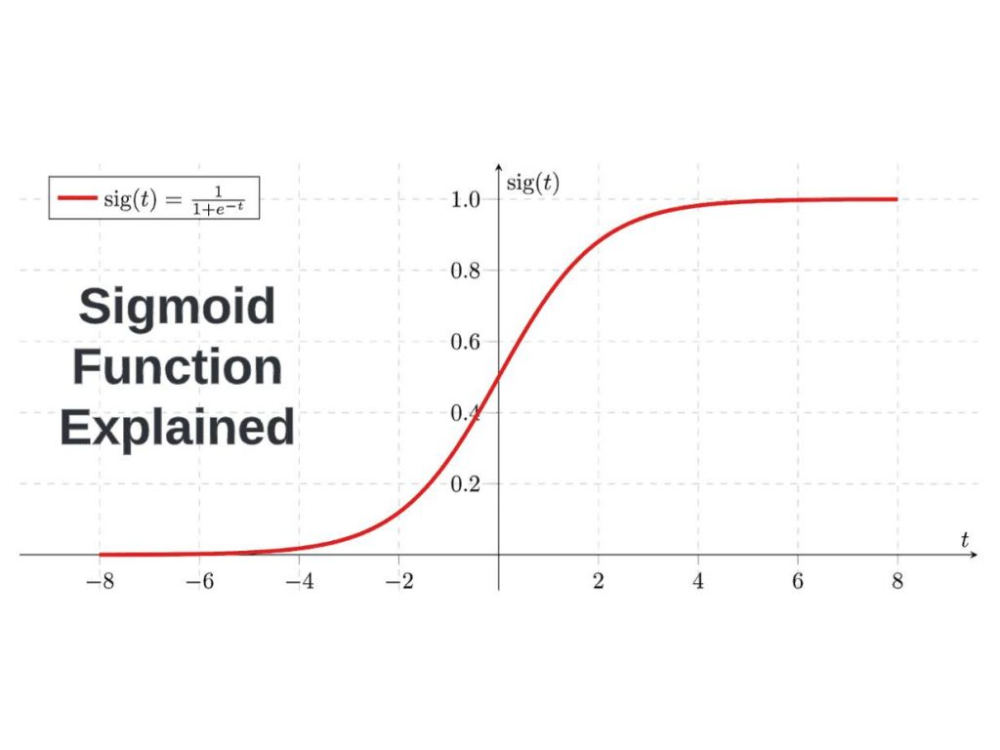
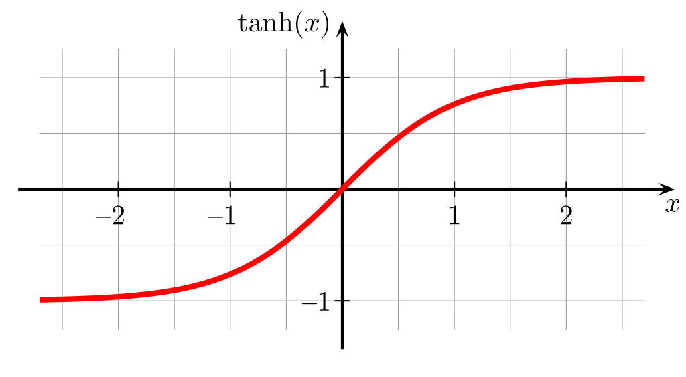
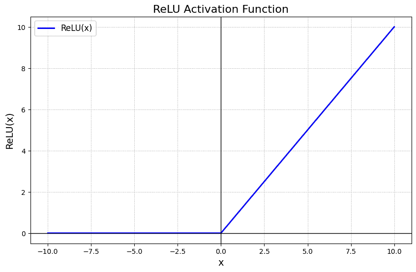

# Activation Functions – Hinglish Interview Revision Notes

Beginner-friendly • Interview-oriented • Short revision notes

## 01. What are activation functions, and why are they needed in neural networks?

Activation Function ek mathematical function hota hai jo neuron ke weighted sum ko process karke final output generate karta hai.

Neural network mein pehle weighted sum calculate hota hai:

\\[ z = w_1x_1+w_2x_2+b \\]

Uske baad activation function apply hota hai:

\\[ a=f(z) \\]

Why are they needed?

Activation functions ka primary purpose neural networks mein non-linearity introduce karna hai.

Agar hum activation functions use nahi karte, toh chahe kitni bhi hidden layers add kar dein, neural network mathematically ek single linear transformation ki tarah behave karega.

Is wajah se model complex patterns aur relationships learn nahi kar payega.

Activation functions model ko complex, non-linear relationships learn karne mein help karte hain.

## 02. What is the mathematical intuition behind an activation function, and how does it introduce non-linearity?

Mathematically, activation function weighted sum \\(z\\) ko ek different output mein transform karta hai.

\\[ z=Wx+b \\]

\\[ a=f(z) \\]

Without Activation Function:

Multiple layers mein sirf multiplication aur addition hota hai. Ye linear transformations hain.

Example:

\\[ h_1=w_1x+b_1 \\]

\\[ h_2=w_2h_1+b_2 \\]

Inko combine karne par:

\\[ h_2=w_2w_1x+w_2b_1+b_2 \\]

Notice karo final output abhi bhi linear hai, chahe hum multiple layers use karein.

With Activation Function:

Ab weighted sum ko ReLU se pass karte hain:

\\[ ReLU(z)=\max(0,z) \\]

- Positive input → Same output.
- Negative input → Zero output.

Example: ReLU(-5) = 0, ReLU(5) = 5.

Is tarah activation function non-linear transformation introduce karta hai, jisse neural network complex patterns aur relationships learn kar pata hai.

Key takeaway: Without activation functions, neural network behaves like a linear model. With activation functions, it can learn non-linear and complex patterns.

## 03. What is the Sigmoid activation function, and what are its mathematical properties and limitations?

Sigmoid

\\[ \sigma(x)=\frac{1}{1+e^{-x}} \\]

[Medium](https://images.openai.com/static-rsc-4/YFJBdDquttwOcH0SuzbxcEyUFJhB46g2fNiHfZWeLbZhu3fJQ0BdTh2CifyxXb80ta-MC8_jrUGjroCtNLk7b2cKDCX95JZqWmQ9yzc2wGGa5DzJz0XWn_hKCMvVMnwJFqNr7Yw9wHlavlbxrfdN0YBIs8F68C0uX-O6656xRsE?purpose=inline)

Properties:

- Output range: 0 to 1.
- S-shaped curve.
- Large positive input → output approaches 1.
- Large negative input → output approaches 0.

Limitations:

- vanishing gradient

Where is it used?

- Binary classification output layer.
- Probability prediction.

Interview takeaway: Sigmoid is useful for binary classification because its output can represent probabilities, but it is generally avoided in deep hidden layers due to vanishing gradients.

## 04. What is the Tanh activation function, and how does it differ from Sigmoid?

Tanh

\\[ \tanh(x)=\frac{e^x-e^{-x}}{e^x+e^{-x}} \\]

[Excurse: Activation functions and the vanishing gradient problem - Fabrizio Musacchio](https://images.openai.com/static-rsc-4/exzv0pk__4rHYflbhy4Y-FTVEv-aZi_uJqKBJ1pNpItzPQon1dcnr69ggNpp7cbAGD5E_Pq-Cs6sa2gJO6UYUyZURNaHH3fqHakfyZx3WHgeEPzidoqhepdbM2f11jnFqzXpmdTS4dIAy-ItXMspOWHMh_DL36jEd2YAgr1kew8?purpose=inline)

Properties:

- Output range: -1 to +1.
- Zero-centered.
- Negative inputs produce negative outputs.
- Positive inputs produce positive outputs.

Sigmoid se difference: <mark style="background-color:rgba(255, 221, 0, 0.28);color:inherit;border-radius:3px;padding:0.1em 0.2em;box-decoration-break:clone;-webkit-box-decoration-break:clone;">Tanh ka output −1 se +1 ke beech hota hai, jabki Sigmoid ka output 0 se 1 ke beech hota hai.</mark>

Limitations:

- vanishing gradient

Interview takeaway: Tanh is zero-centered, unlike Sigmoid, but both suffer from vanishing gradients.

## 05. What is the ReLU activation function, how does it work, and what is the Dying ReLU problem?

<strong>ReLU (Rectified Linear Unit)</strong> hidden layers mein use hone wala activation function hai. Ye non-linearity introduce karta hai.

ReLU input ko zero aur positive infinity ke beech map karta hai:
<math class="activation-equation" xmlns="http://www.w3.org/1998/Math/MathML" display="block" aria-label="f(x)=max(0,x)"><mrow><mi>f</mi><mo>(</mo><mi>x</mi><mo>)</mo><mo>=</mo><mi>max</mi><mo>(</mo><mn>0</mn><mo>,</mo><mi>x</mi><mo>)</mo></mrow></math><figure style="display:flex;flex-wrap:wrap;align-items:center;gap:24px;margin:24px 0;"><figcaption style="flex:1 1 220px;min-width:0;">
Yeh activation function agar input <strong>x &lt; 0</strong> ho, toh usko <strong>0</strong> kar deta hai.

Aur agar input <strong>x &gt; 0</strong> ho, toh usko <strong>same return</strong> kar deta hai.
</figcaption>

</figure>
<strong>Example:</strong> ReLU(5) = 5, ReLU(0) = 0, ReLU(-3) = 0. Positive side seedhi line hai, lekin negative side ko 0 karne ki wajah se poora function non-linear hai.

<strong>Derivative aur gradient descent:</strong> Backpropagation loss ka gradient calculate karta hai. Ismein aage se aane wala gradient activation ke derivative se multiply hota hai; gradient descent us gradient se weights update karta hai: <code>w_new = w_old - learning_rate * dL/dw</code>.
<ul><li><strong>x &gt; 0:</strong> Output x hai aur derivative 1. ReLU(5) = 5, lekin derivative 1 hai; ReLU(10) = 10 par bhi derivative 1 hi hai. Gradient bina shrink hue pass hota hai.</li><li><strong>x &lt; 0:</strong> Output constant 0 hai, isliye derivative 0. Gradient * 0 = 0; is neuron ke incoming weights ko us example se learning signal nahi milta.</li></ul>
<strong>Advantages:</strong> Calculation simple aur fast hai. <mark style="background-color:rgba(255, 221, 0, 0.28);color:inherit;border-radius:3px;padding:0.1em 0.2em;box-decoration-break:clone;-webkit-box-decoration-break:clone;">Positive side par derivative 1 rehne se activation ki wajah se vanishing gradient nahi hota.</mark>

<strong>Dying ReLU:</strong> Agar neuron ke inputs lagataar negative rahein, toh output aur gradient 0 reh sakte hain. Neuron inactive ho sakta hai; Leaky ReLU negative side par small gradient dekar is risk ko kam karta hai.

<strong>Must watch for better clarity:</strong> <a href="https://youtu.be/xyo2ELUOpqg" target="_blank" rel="noopener noreferrer">ReLU aur Leaky ReLU video explanation</a>

## 06. What is Leaky ReLU, and how does it help with the Dying ReLU problem?

<strong>Leaky ReLU</strong>, ReLU ka variant hai. Positive input same return hota hai; negative input ko 0 karne ki jagah small positive constant <strong>alpha</strong>, jaise 0.01, se multiply karta hai.
<math class="activation-equation" xmlns="http://www.w3.org/1998/Math/MathML" display="block" aria-label="f(x) = max(alpha x, x), where 0 less than alpha less than 1"><mrow><mi>f</mi><mo>(</mo><mi>x</mi><mo>)</mo><mo>=</mo><mi>max</mi><mo>(</mo><mi>alpha</mi><mi>x</mi><mo>,</mo><mi>x</mi><mo>)</mo></mrow></math><ul><li><strong>x &gt; 0:</strong> Output x; derivative 1.</li><li><strong>x &lt; 0:</strong> Output alpha * x; derivative alpha.</li></ul>
<strong>Example:</strong> Alpha = 0.01 ho, toh Leaky ReLU(5) = 5 aur derivative 1; Leaky ReLU(-5) = -0.05 aur derivative 0.01.

<strong>Derivative aur gradient descent:</strong> Negative side par bhi derivative 0 nahi hota. Aage se gradient 2 aaye aur alpha = 0.01 ho, toh backpropagation mein gradient 2 * 0.01 = 0.02 pass hoga; normal ReLU mein yeh 0 hota. Isse incoming weights ko learning signal mil sakta hai aur gradient descent unhe update kar sakta hai.

<strong>Advantage:</strong> Negative side par small slope hone se neuron ke inactive rehne aur Dying ReLU ka risk kam hota hai. Graph negative side par flat hone ki jagah halka slope rakhta hai; output range <strong>(-infinity, +infinity)</strong> hota hai.

<strong>Yaad rakho:</strong> ReLU negative input ko 0 karta hai; Leaky ReLU small negative output aur non-zero gradient deta hai.

<strong>Must watch for better clarity:</strong> <a href="https://youtu.be/xyo2ELUOpqg" target="_blank" rel="noopener noreferrer">ReLU aur Leaky ReLU video explanation</a>

## 07. What is GELU, and how does its behaviour differ from ReLU?

GELU

GELU = Gaussian Error Linear Unit.

\\[ GELU(x)=x\Phi(x) \\]

Yahan \\(\Phi(x)\\) standard Gaussian distribution ka CDF hai.

[Encoder Architecture: Bidirectional Transformers for Understanding Tasks - Interactive | Michael Brenndoerfer | Michael Brenndoerfer](https://images.openai.com/static-rsc-4/z7U_y_bZ0IotBcvgMsYFrOWnROr5Rn2MR-AU52N2adnztgJSWymlELrYrNUZMav5VKShDKOu_1Q0-Y1hLR2Sk6Ba1X-eJ4_w6bRuKYG32yfVnV-oQHOnEXmsL645LJJvTJi2UmOSt7glWaOjrYorsYEOVFXC0KdHz72RyZHewBM?purpose=inline)

How does it work?

- ReLU negative values ko completely zero kar deta hai.
- GELU negative values ko smoothly suppress karta hai.
- GELU input magnitude ke basis par values ko weight karta hai.
- Iska transition ReLU ke comparison mein smooth hota hai.

ReLU vs GELU:

| ReLU                    | GELU                           |
| ----------------------- | ------------------------------ |
| Hard zero for negatives | Smooth suppression             |
| Simple max operation    | More computationally expensive |
| Piecewise linear        | Smooth nonlinear               |
| CNNs, MLPs              | Transformers, BERT             |

Interview takeaway: GELU provides a smoother activation than ReLU and is widely used in Transformer architectures.

## 08. What is SwiGLU, and how does its gated mechanism work?

SwiGLU

SwiGLU = Swish + Gated Linear Unit.

Basic intuition:

Normal activation function input ko transform karta hai, whereas SwiGLU mein ek additional gate hota hai jo information control karta hai.

\\[ SwiGLU(x)=(xW_1)\odot Swish(xW_2) \\]

Where:

- \\(W_1,W_2\\) = learnable weight matrices.
- Swish = smooth activation function.
- \\(\odot\\) = element-wise multiplication.

How does it work?

1. Input two different linear transformations se pass hota hai.
2. One branch information generate karta hai.
3. Second branch gate ki tarah behave karta hai.
4. Dono branches element-wise multiply hoti hain.

[T-one — открытая русскоязычная потоковая модель для телефонии / Хабр](https://images.openai.com/static-rsc-4/zD8IEd3dbufY-pMuZJPTR30fsLkXYE0b-vAgQgMkpYRYGqnvGK7DbXZqJznPKXfj3xtgiOjB2Wh1-qMXpzY5r14pyY4-WcQlSeDHX40-LnTC3Sa0103BVbFM0fQCZa7MkHg5J6lCg1SGNr9QToi_ny94n_LOCIA-2WuD6qOqFnU?purpose=inline)

Where is it used?

- Modern Transformer architectures.
- LLaMA-family models.
- Large Language Models.

Interview takeaway: SwiGLU uses a gating mechanism to control information flow and improve the expressive capacity of Transformer feed-forward networks.

## 09. What is the vanishing gradient problem, and how do different activation functions contribute to it?

Definition: Vanishing gradient tab hota hai jab backpropagation ke during gradients bahut small ho jaate hain.

As a result, early layers mein weights effectively update nahi ho paate.

Simple intuition:

Imagine gradient har layer mein 0.1 se multiply ho raha hai:

\\[ 0.1 \times 0.1 \times 0.1 = 0.001 \\]

Multiple layers ke baad gradient extremely small ho sakta hai.

Activation functions ka role:

- Sigmoid: Saturation regions mein gradients almost zero ho jaate hain.
- Tanh: Extreme positive/negative values par gradients small ho jaate hain.
- ReLU: Positive side par gradient 1 hota hai, negative side par 0.
- GELU: Smooth gradients provide karta hai, but vanishing gradients ko completely eliminate nahi karta.
- SwiGLU: Gating aur smooth activation provide karta hai, but vanishing gradients ka complete solution nahi hai.

Interview takeaway: Vanishing gradients make early layers learn slowly. ReLU and modern activation functions help, but do not completely eliminate this problem.

## 10. How do Sigmoid, Tanh, ReLU, GELU, and SwiGLU compare?

| Activation | Output range                 | Gradient behaviour       | Cost        |
| ---------- | ---------------------------- | ------------------------ | ----------- |
| Sigmoid    | (0, 1)                       | Vanishing                | Medium      |
| Tanh       | (-1, 1)                      | Vanishing                | Medium      |
| ReLU       | [0, ∞)                       | Zero for negative inputs | Low         |
| GELU       | Approximately (-0.17, ∞)     | Smooth                   | Medium–High |
| SwiGLU     | Depends on input and weights | Gated, smooth            | High        |

Typical applications:

| Activation | Applications          |
| ---------- | --------------------- |
| Sigmoid    | Binary classification |
| Tanh       | Traditional RNNs      |
| ReLU       | CNNs, MLPs            |
| GELU       | BERT, Transformers    |
| SwiGLU     | LLaMA and modern LLMs |

Interview takeaway: No single activation function is best for every situation. Selection depends on architecture, computational budget and learning requirements.

## 11. Why are GELU and SwiGLU commonly used in modern Transformer architectures instead of traditional activation functions?

GELU:

- Smooth activation.
- Gradually suppresses negative values.
- Works well in Transformer feed-forward networks.
- Used in BERT and other Transformer architectures.

SwiGLU:

- Uses a gating mechanism.
- Controls how much information passes through.
- Provides greater expressive flexibility.
- Used in several modern LLM architectures, including LLaMA.

Why not traditional ReLU everywhere?

ReLU is simple and fast, but GELU and SwiGLU offer smoother or gated transformations that can work better in certain Transformer architectures.

Interview takeaway: GELU and SwiGLU are popular because they provide useful nonlinear transformations, and SwiGLU additionally offers controlled information flow through gating.

## Final Quick Revision – Remember These 5 Things

| Activation | Remember this                 |
| ---------- | ----------------------------- |
| Sigmoid    | Probability between 0 and 1   |
| Tanh       | Zero-centered, -1 to +1       |
| ReLU       | Negative = 0, positive = same |
| GELU       | Smooth ReLU-like activation   |
| SwiGLU     | Gating + Swish                |

## Interview Self-Test

5 MCQs – Test your understanding

0/5 answered

1\. Which activation function is zero-centered?

Sigmoid

Tanh

ReLU

GELU

2\. Which activation function suffers from the Dying ReLU problem?

Sigmoid

Tanh

ReLU

SwiGLU

3\. Which activation function is commonly associated with BERT?

GELU

Sigmoid

Tanh

ReLU

4\. What makes SwiGLU different?

Probability output

Gating mechanism

Only positive outputs

Hard zero threshold

5\. Which activation is most likely to suffer from saturation-based vanishing gradients?

ReLU

Sigmoid

SwiGLU

GELU

Check answers